<!-- markdownlint-disable MD013 MD025 MD033 -->

> 给非技术用户的第一本备份指南：不讲命令行，只讲日常会用到的部分。

**Windows 10 / 11 · KopiaUI v0.23.x · 英文界面逐项对照**

Kopia 很好用，但只有英文界面，选项也偏技术。好消息是：**日常要用的功能只有十几个按钮**。本教程按「安装 → 建仓库 → 设策略 → 首次备份 → 恢复」走一遍，并把每个英文按钮翻成中文。内容基于 KopiaUI v0.23.1（2026 年 6 月），新版本界面可能略有差异，以你屏幕上看到的为准。

## 先认识这些标记

| **你会看到** | **它是什么意思** |
|---|---|
| **加粗的英文** | 界面上的原文。请照着这个英文去找按钮、选项。 |
| `等宽文字` | 需要输入的内容，例如文件夹路径或命令。 |
| 〔截图〕 | 界面截图，帮你对照位置和文字。 |
| 蓝色框 / 黄色框 / 红色框 | 小贴士 / 容易做错的地方 / 可能影响数据安全的提醒。 |

*表 1  教程里的标记说明*

## 一分钟速查卡

配置完成后，日常只需要记住这 6 步（现在看不懂没关系，做完第 3～6 章再回来看）：

| **□** | **要做的事** | **在哪一章** |
|---|---|---|
| □ | 安装并打开 KopiaUI（托盘有图标） | 第 3 章 |
| □ | 创建一个仓库，设好密码并记牢 | 第 4 章 |
| □ | 把要备份的文件夹加进策略 | 第 5 章 |
| □ | 设置自动备份频率（推荐 every hour） | 5.4 节 |
| □ | 手动跑一次，确认第一次备份成功 | 第 6 章 |
| □ | 恢复一个小文件，确认真的能找回 | 第 8 章 |

*表 2  一分钟速查卡*

## 第 1 章  先认识 Kopia

这一章不操作，只把最重要的几个概念讲清楚。概念懂了，后面的英文界面就不容易点错。

### 1.1 用一句话理解 Kopia

**Kopia 是给文件夹「拍快照」的备份工具。**  每拍一次，它就记录下当时文件夹里所有文件的样子，然后加密、压缩，存到你在别处准备好的「仓库」里。将来任何时候，都能把某一次快照里的文件找回来。

和网盘同步对比一下就明白了：

| **情况** | **网盘同步（如 OneDrive）** | **Kopia 快照备份** |
|---|---|---|
| 本地误删了文件 | 同步盘里通常也被删掉 | 快照里还在，可以找回删除前的版本 |
| 文件被改坏、被勒索病毒加密 | 好版本可能已被覆盖 | 历史快照不受影响，可整体或单个恢复 |
| 想找三个月前的版本 | 多数网盘不保留这么久 | 只要在保留范围内，随时可翻出来 |
| 占多少空间 | 只存当前版本 | 只存变化的部分，多份快照共用仓库，很省空间 |
| 主要用途 | 多设备同步、协作 | 防误删、防损坏、防丢失 |

*表 3  网盘同步和 Kopia 的区别*

> ⚠️ **别把 Kopia 当网盘用**
>
> Kopia 只做「备份 + 恢复」，不做双向同步。它是数据的保险柜，不是第二份可编辑的网盘。

### 1.2 三个核心概念

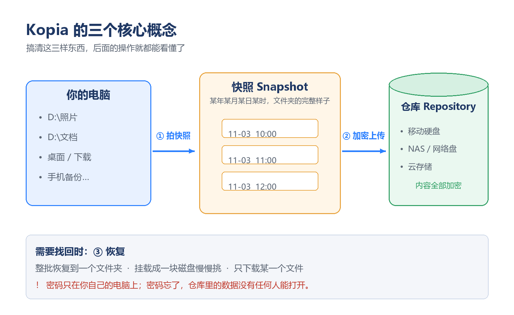

| **英文原文** | **中文** | **一句话解释** |
|---|---|---|
| Repository | 仓库 | 存放所有快照的地方，可以是移动硬盘、NAS 或云存储。整个仓库都是加密的。 |
| Snapshot | 快照 | 某一次备份的「时间点照片」。一个文件夹可以有很多个快照。 |
| Policy | 策略 | 告诉 Kopia：备份哪个文件夹、多久备一次、旧快照保留多少、要不要压缩。 |
| Source | 源目录 | 你要备份的那个文件夹本身，例如 D:照片。 |
| Repository Password | 仓库密码 | 加密仓库用的密码。**只保存在你自己的电脑上**，忘了就再也打不开仓库。 |

*表 4  五个必须先认识的名词*

### 1.3 为什么它备份快、又不占地方

第一次备份会把所有文件读一遍；从第二次开始，Kopia 只上传**变化过的内容**。它还会做「去重」：同一个文件即使被改名、移动，或在两台电脑上各有一份，仓库里也只存一份。所以后续备份往往几秒钟就完成。

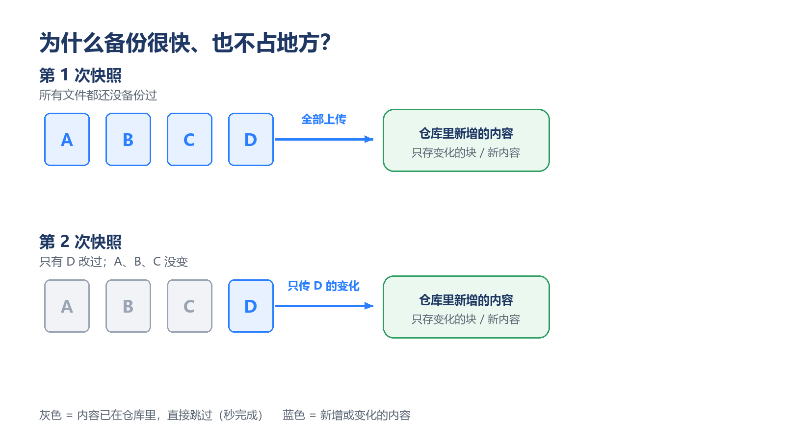

这也意味着：**快照多，不等于占用空间翻倍**。你可以放心地多留一些历史版本。

### 1.4 Kopia 不做什么（先说清楚，避免误会）

| **它不做的事** | **你需要知道的** |
|---|---|
| 不是系统镜像工具 | 它备份的是文件，不是整个 Windows 系统。系统盘坏了要先重装，再用 Kopia 把文件恢复回来。 |
| 不会替你买云存储 | 用云存储前，得先在云服务商那里开好账号、建好存储桶并拿到密钥。 |
| 不能找回忘记的密码 | 密码只在你电脑上，官方明确说明没有任何办法恢复。请务必用密码管理器保存。 |
| 不做双向同步 | 删掉本地文件不会删掉旧快照；但想让两台电脑文件保持一致，应该用同步工具。 |
| 不适合备份正在独占写入的数据库 | 家庭用户很少遇到；备份 SQL 数据库之类需要先做导出。 |

*表 5  Kopia 的边界*

### 1.5 界面地图：五个标签页

主窗口上方有五个标签，所有功能都在这五个页面里：

| **标签（英文）** | **中文** | **用来做什么** |
|---|---|---|
| **Snapshots** | 快照 | 看备份了哪些文件夹、最近一次备份时间；手动点 **Snapshot Now**；点进去恢复文件。 |
| **Policies** | 策略 | 添加要备份的文件夹，设置备份频率、保留数量、压缩和忽略规则。 |
| **Tasks** | 任务 | 查看运行中、已完成或失败的任务（备份、恢复、维护都会出现在这里）。 |
| **Repository** | 仓库 | 查看当前仓库信息、修改仓库描述、断开连接。 |
| **Preferences** | 偏好设置 | 修改界面主题、显示大小、容量单位。 |

*表 6  主界面的五个标签页*

还有两个位置要注意：

- 窗口标题栏显示的是**仓库描述**（例如 `filesystem: D:\Kopia仓库`），不是软件名；点它可以直接跳到 Repository 页。
- 屏幕右下角的**托盘图标**才是 KopiaUI 的本体。关闭窗口只是关掉界面，备份仍在后台按计划运行；要真正退出，得在托盘菜单里点 **Quit**。

> ℹ️ **刚装好、还没连仓库时**
>
> Snapshots / Policies / Tasks 三个标签是灰色不可点的，鼠标悬停提示 **Repository is not connected**。这是正常的，做完第 4 章就会亮起来。

## 第 2 章  动手前的 6 个决定

安装之前先花十分钟想清楚这几件事，可以少走很多弯路。想不明白也没关系，每节都给了适合新手的默认选择。

### 2.1 决定一：仓库放在哪里

| **仓库位置** | **优点** | **缺点** | **适合谁** |
|---|---|---|---|
| 移动硬盘 | 便宜、容量大、断网也能用，最省心 | 硬盘本身会坏、可能丢失；需要定期插上电脑 | **新手首选**，尤其是照片/文档多的人 |
| 另一块内置硬盘 | 速度快、不用插拔 | 和系统盘一起坏的风险仍在 | 台式机、有第二块硬盘的人 |
| NAS / 网络盘 | 全家共享、可异地摆放 | NAS 关机或断网时备份会失败 | 家里已有 NAS 的人 |
| 云存储（对象存储） | 天然异地，防火防盗 | 需要注册、付费、配置密钥；受网速限制 | 愿意折腾、重视异地备份的人 |
| OneDrive / Google Drive 等网盘 | 已有账号就能用 | Kopia 只能通过 rclone 间接支持，属实验性用法 | 不推荐新手一开始就用 |

*表 7  仓库位置怎么选*

> 🚨 **三条铁律**
>
> - **仓库绝对不能放在要备份的文件夹里面**，否则会自己备份自己，越滚越大。
> - **不要只放在和原始数据同一块硬盘上**：硬盘一坏，数据和备份一起没。
> - 做到「3-2-1」：至少 3 份数据、2 种介质、1 份放在别的地方（见图 3）。

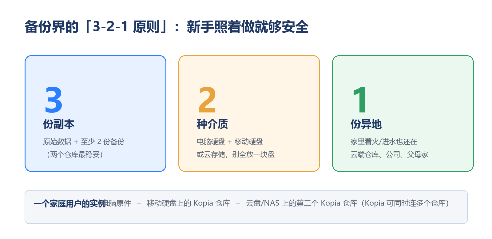

Kopia 可以**同时连接多个仓库**（托盘菜单 → **Connect To Another Repository...** ），所以可以先备份到移动硬盘，等熟悉了再加一个云端仓库，同一份数据就有两份备份。

### 2.2 决定二：备份哪些文件夹

原则：**备份你自己产生的、丢了会心疼的数据**，而不是整个硬盘。

| **建议备份** | **一般不用备份（或需要单独排除）** |
|---|---|
| 桌面、文档、图片、音乐、视频 | Windows 系统目录、Program Files |
| 浏览器书签（先导出为 HTML） | 整个 AppData 目录（里面有大量缓存） |
| 微信 / QQ 的聊天文件目录 | 软件缓存、临时文件、回收站 |
| 游戏存档、代码项目 | 游戏安装目录（重装即可，体积巨大） |
| 财务、证件、合同等重要文件（建议再单独加密一份） | 虚拟机磁盘、系统备份文件 |

*表 8  该备份什么、不该备份什么*

不知道文件夹有多大？在资源管理器里右键文件夹 → **属性**，看「大小」。第一次备份 100 GB 以内，用移动硬盘一般一两个小时能传完。

### 2.3 决定三：多久备份一次

| **频率（界面上的值）** | **适合的情况** | **说明** |
|---|---|---|
| **every hour**（每小时） | **大多数人的推荐值** | 变化不频繁的电脑，一小时一次足够；快照很轻，不会拖慢电脑。 |
| every 3 hours / every 6 hours | 笔记本、经常不插电 | 省电、减少唤醒；记得勾选 **Launch At Startup**。 |
| every 12 hours 等更长间隔 | 变化很少的资料盘 | 够用，但最多可能丢半天的新文件。 |
| **(none)** | 只想手动备份 | 不会自动跑，需要自己点 **Snapshot Now**。 |

*表 9  备份频率怎么选*

新手建议：频率选 **every hour**，并在托盘菜单里勾选 **Launch At Startup**。KopiaUI 关窗口不会退出，但点了托盘里的 **Quit** 就不会再按时备份了。

### 2.4 决定四：旧快照保留多少

Kopia 用「保留策略」自动清理旧快照，默认值已经比较合理：最近 10 个快照 + 每小时 48 个 + 每天 7 个 + 每周 4 个 + 每月 24 个 + 每年 3 个。你不需要理解每一项，只要知道：**保留得越多，仓库越大**；**不要把任何一项改成 0**，那等于放弃对应时间跨度的历史版本。具体字段见 5.5 节。

### 2.5 决定五：密码怎么管

仓库密码是**唯一能打开你备份的钥匙**。Kopia 官方写得很直白：忘记密码就**没有任何办法**恢复仓库里的数据，连官方也帮不了你。

| **要做** | **不要做** |
|---|---|
| 用密码管理器（Bitwarden、1Password、KeePass 等）保存 | 只记在脑子里 |
| 写在一张纸上，放在家里安全的地方（和备份硬盘分开放） | 存在仓库所在的那块硬盘里 |
| 密码长度至少 16 位，混合大小写、数字和符号 | 用生日、手机号、123456 |
| 如果家人也要用这个仓库，把密码安全地告诉他们 | 把密码贴在显示器上或截图发到群里 |

*表 10  密码管理清单*

KopiaUI 会在本机保存连接信息，所以平时打开软件不需要反复输密码。但这不代表可以忘记密码——**重装系统、换电脑、把仓库接到另一台电脑时，都必须重新输入它**。

### 2.6 决定六：先想好怎么恢复

没有验证过恢复的备份，只能算「可能有用」。第 8 章会带你实际找回一次文件。建议养成习惯：**每个季度做一次恢复演练**，随便找回一个小文件，确认仓库和密码都还正常。

## 第 3 章  安装 KopiaUI

本章大约需要 10 分钟。装好后先别急着配置，下一章才创建仓库。

### 3.1 下载安装包

**1.**  打开浏览器访问 `https://kopia.io/docs/installation/`（或直接打开 `https://github.com/kopia/kopia/releases/latest`）。

**2.**  在页面里找到 **Official Releases** 链接，点进 GitHub 的 Releases 页面。

**3.**  在最新版本的 **Assets** 列表里，找到文件名形如 **KopiaUI-Setup-0.23.1.exe** 的安装包，点它下载。

**4.**  下载完成后，确认文件大小在 100 MB 左右，文件名以 `.exe` 结尾。

| **文件名 / 命令** | **说明** |
|---|---|
| **KopiaUI-Setup-0.23.1.exe** | **你要下载的就是这个**：桌面图形界面版安装包，内置命令行工具。 |
| KopiaUI-0.23.1-win.zip | 便携版（免安装），解压后运行；适合放 U 盘里带走。 |
| KopiaCLI-0.23.1-windows-x64.zip | 只有命令行，没有图形界面；新手不用下。 |
| `winget install Kopia.KopiaUI` | 如果你会用命令行，可以用 winget 一条命令安装。 |

*表 11  下载哪个文件*

> ℹ️ **系统要求**
>
> Windows 10 或更高版本、64 位。Windows 7 / 8 不在官方支持范围内。

> ⚠️ **只从官网或 GitHub 官方仓库下载**
>
> 不要从第三方软件下载站获取安装包。备份软件权限很高，来路不明的安装包风险极大。

### 3.2 安装

**1.**  双击下载好的 **KopiaUI-Setup-0.23.1.exe**。

**2.**  如果 Windows 弹出蓝色的「Windows 已保护你的电脑」（SmartScreen 提示），点 **更多信息** → **仍要运行**。这是因为个人开发者软件没有购买商业签名，不是病毒。

**3.**  安装向导里一路点 **Next** / **Install**，最后点 **Finish**。安装位置保持默认即可。

**4.**  安装完成后 KopiaUI 通常会自动启动，屏幕右下角的托盘区出现一个 Kopia 图标。安装程序会同时装好图形界面和命令行工具，你不用管命令行。

### 3.3 第一次启动会看到什么

第一次启动时，KopiaUI 会做两件事：

- 在托盘弹出一个气泡：**Kopia is running in the background** / **Click on the system tray icon to open the menu**。
- 打开主窗口，标题栏先显示 **KopiaUI is Loading...** ，加载完成后进入 **Select Storage Type** 页面——这就是创建仓库的入口。

如果窗口没弹出来或被关掉了，**单击/右键点击托盘里的 Kopia 图标**，在菜单里点你的仓库名称就能重新打开；双击托盘图标会打开所有仓库窗口。

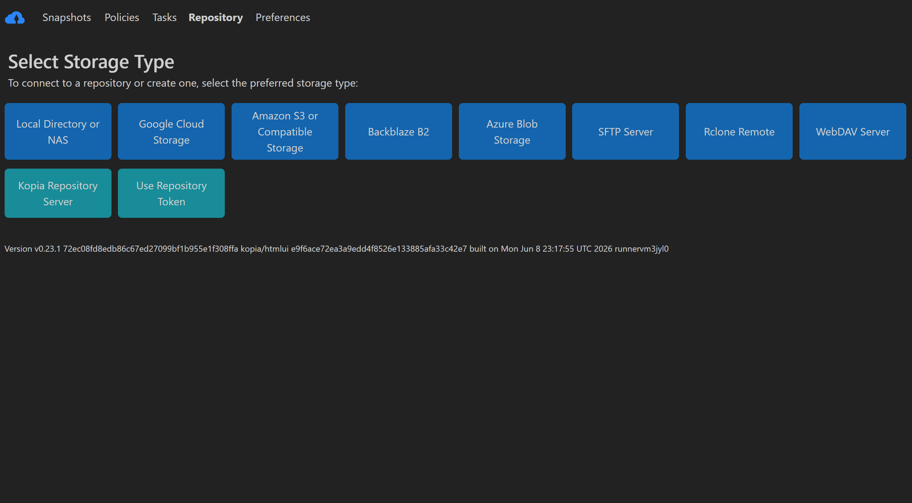

托盘图标的三个操作，很多人一开始会搞混：

| **操作** | **效果** |
|---|---|
| 单击 / 右键 | 弹出托盘菜单（仓库列表、更新、开机自启、退出等）。 |
| 双击 | 打开所有已连接仓库的主窗口。 |
| 关闭主窗口的 × | 只是隐藏窗口，程序仍在托盘里按计划备份。 |
| 托盘菜单 → **Quit** | 真正退出 KopiaUI（退出后不会自动备份）。 |

*表 12  托盘图标的操作*

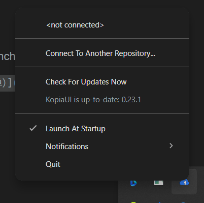

### 3.4 让它常驻：开机自启和通知

备份软件最有价值的时刻，是你忘记它的时候。建议做两件事：

**1.**  打开托盘菜单，勾选 **Launch At Startup**（开机自动启动）。

**2.**  同一菜单里的 **Notifications** 子菜单，保持 **Enabled** 或改成 **Warnings And Errors**（只在出错时提醒），避免每天弹通知。

这样每次开机 KopiaUI 都会自动在后台待命，到点就备份，不需要你操心。

### 3.5 更新软件

KopiaUI 每 24 小时自动检查一次新版本，结果显示在托盘菜单里：

| **托盘菜单显示** | **含义 / 怎么做** |
|---|---|
| **KopiaUI is up-to-date: 0.23.1** | 已是最新版，不用管。 |
| **Update Available: v0.23.x** | 有新版本。点下方的 **Download And Install...**  下载安装，装完会自动重启。 |
| **Update Failed, click to manually download...** | 自动更新失败，点它打开下载页，手动下载安装包覆盖安装即可。 |
| **Check For Updates Now** | 不想等自动检查时，点它立刻检查。 |

*表 13  更新提示怎么处理*

> ⚠️ **更新前**
>
> 如果正在跑快照或恢复，等任务结束再更新。更新只替换软件本体，不会动你的仓库和设置。

## 第 4 章  创建第一个仓库

仓库（Repository）是存放所有备份的地方。这一章会创建一个仓库并设好密码。请准备好你在第 2 章决定的位置，例如一块移动硬盘（先插上电脑）或一个空文件夹。

### 4.1 选择存储类型

在 **Select Storage Type** 页面，Kopia 列出了所有支持的存储位置。按钮很多，新手只需要认识前两个：

| **按钮（英文原文）** | **中文** | **说明** |
|---|---|---|
| **Local Directory or NAS** | 本地文件夹或 NAS | **新手选这个。**  移动硬盘、另一块硬盘、映射好的网络盘都从这里进入。 |
| **Google Cloud Storage** | 谷歌云存储 | 需要先在谷歌云创建存储桶并拿到密钥。 |
| **Amazon S3 or Compatible Storage** | 亚马逊 S3 及兼容存储 | 很多对象存储（如 MinIO、Cloudflare R2）走这个入口。 |
| **Backblaze B2** | B2 云存储 | 便宜的大容量云存储，需要账号和密钥。 |
| **Azure Blob Storage** | 微软云存储 | 需要订阅和容器。 |
| **SFTP Server** | SFTP 服务器 | 通过 SSH 连到服务器保存，适合有服务器的人。 |
| **Rclone Remote** | rclone 远程 | 实验性功能，可间接使用 OneDrive、Google Drive、Dropbox 等。 |
| **WebDAV Server** | WebDAV 服务器 | 部分网盘/NAS 提供 WebDAV 接口。 |
| **Kopia Repository Server** | Kopia 仓库服务器 | 团队多台电脑共用一个服务器时使用，新手用不到。 |
| **Use Repository Token** | 使用仓库令牌 | 别人把一个仓库的访问令牌发给你时，用它连接。 |

*表 14  十个存储类型按钮*

> 💡 **不知道选哪个？**
>
> 选 **Local Directory or NAS**。移动硬盘、U 盘、NAS 映射出来的网络盘，都属于「本地文件夹」。

### 4.2 指定仓库文件夹

**1.**  点 **Local Directory or NAS**，进入 **Storage Configuration** 页面。

**2.**  在 **Directory Path** 输入框里填一个**专用空文件夹**，例如 `D:\Kopia仓库` 或移动硬盘上的 `E:\Kopia仓库`。也可以点右侧的浏览按钮选择。

**3.**  点 **Next** 继续。

输入框的完整提示语是 **enter directory path where you want to store repository files**。建议新建一个空文件夹专门放仓库，不要和其他资料混在一起——以后迁移时整目录复制就行。

> ⚠️ **路径选错的两大后果**
>
> - 选到了**要备份的文件夹内部**：备份会递归包含仓库自身，空间暴涨。
> - 选到了**系统盘一个会被清理的位置**：仓库可能被误删。请放在数据盘或移动硬盘。

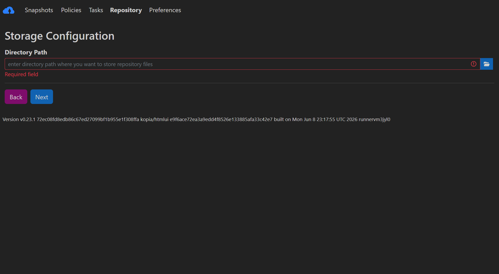

### 4.3 设置仓库密码

如果是全新的空文件夹，Kopia 会显示 **Create New Repository**，要求你设置密码：

| **字段（英文原文）** | **中文** | **怎么填** |
|---|---|---|
| **Repository Password** | 仓库密码 | 至少 16 位的强密码。输入时不会明文显示，这是正常的。 |
| **Confirm Repository Password** | 确认密码 | 再输入一遍。两次不一致会提示 **Passwords don't match**。 |
| **Show Advanced Options** | 显示高级选项 | 点开后可以改加密算法等。**新手请不要改**，保持默认。 |

*表 15  创建仓库时的密码字段*

页面上的说明文字是：**Enter a strong password to create Kopia repository in the provided storage.**  密码旁的帮助文字是 **Used to encrypt the repository's contents**（用于加密仓库内容）。

> 🚨 **记住这句话**
>
> 密码只保存在你的电脑上，不会上传，也不会被 Kopia 官方知道。一旦忘记，官方明确说明**没有任何办法**恢复仓库数据。请在继续前把密码存进密码管理器。

### 4.4 高级选项：全部保持默认

点 **Show Advanced Options** 后会展开加密算法、哈希算法、分块器、仓库格式、错误纠正等选项。它们决定仓库的底层格式，创建后**大部分不能再改**。新手全部保持默认即可（加密默认 AES256-GCM-HMAC-SHA256，仓库格式选 Latest format，错误纠正保持 Disabled）。

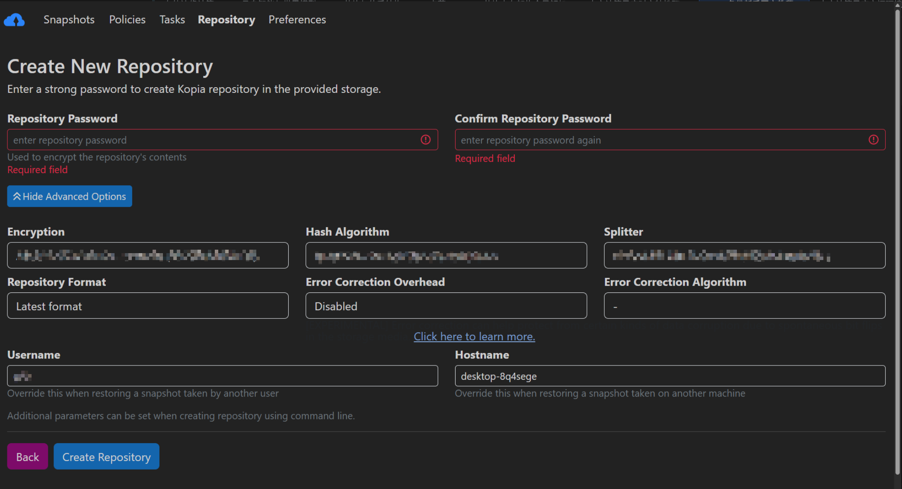

### 4.5 点 Create Repository，等待初始化

**1.**  点 **Create Repository**。

**2.**  页面会显示 **Initializing Repository...** ，下方有 **Show Log** 按钮。首次创建通常 10～60 秒，移动硬盘会久一点。

**3.**  看到顶部标题变成你的仓库描述、并进入 **Snapshots** 页面，就说明创建成功了。

如果报错，先看错误信息：路径不存在、没有写入权限、移动硬盘没插好是最常见的三个原因。处理不了就把完整报错记录下来，对照第 13 章 FAQ。

### 4.6 给仓库起个名字

仓库创建好之后，它的「名字」其实是仓库描述（description）。默认描述通常是存储位置，比如 `filesystem: D:\Kopia仓库`。如果你以后可能连多个仓库，建议改成人能看懂的名字。

**1.**  点顶部标签 **Repository**。

**2.**  页面显示 **Connected To Repository**；在描述输入框里填新名字，例如 `客厅移动硬盘`。

**3.**  点 **Update Description** 保存。留空会提示 **Description Is Required**。

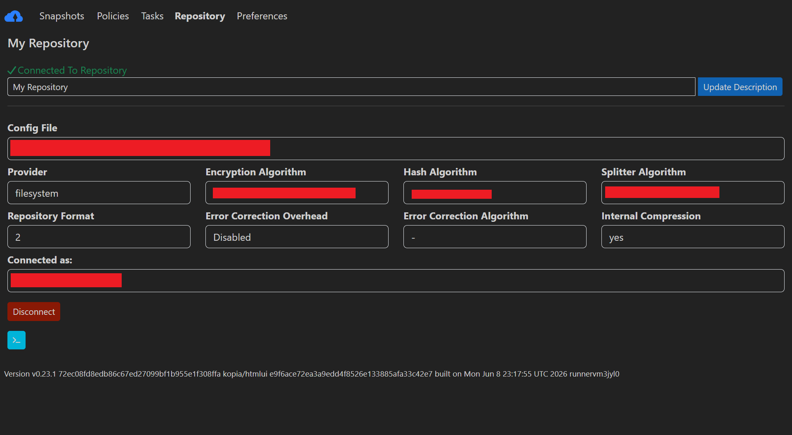

### 4.7 在另一台电脑（或重装后）连接已有仓库

仓库建好后，别的电脑、或者重装系统后的这台电脑，都可以用密码连接它。注意：这时**不要**再点 Create，要找到 **Connect To Repository** 页面。

**1.**  把仓库所在位置准备好（移动硬盘插上，NAS 连上）。

**2.**  如果 KopiaUI 已经连着别的仓库：右键托盘图标 → **Connect To Another Repository...** 。

**3.**  选择存储类型（和创建时一致），填路径，点 **Next**。Kopia 检测到这个位置已有仓库，会显示 **Connect To Repository**。

**4.**  填写 **Repository Password**；**Repository Description** 填一个好认的名字；点 **Connect To Repository**。

| **字段（英文原文）** | **含义** |
|---|---|
| **Connect As** | 以哪个用户身份连接，只读显示，例如 `张三@我的电脑`。 |
| **Repository Password** | 创建仓库时设置的密码。 |
| **Repository Description** | 仓库显示名，方便区分多个仓库。 |
| **Connect in read-only mode** | 只读连接：能看和恢复，但不能创建新快照。换电脑临时取文件时可用。 |

*表 16  连接已有仓库时的字段*

> 💡 **同一台电脑连多个仓库**
>
> 用托盘菜单的 **Connect To Another Repository...**  可以再连一个仓库，主窗口会为每个仓库各开一个窗口。托盘菜单里会列出所有仓库的描述，点哪个就打开哪个。

### 4.8 本章完成检查

- 托盘有 Kopia 图标，菜单里能看到你的仓库描述。
- 主窗口顶部标签 Snapshots / Policies / Tasks 已经可以点击。
- Repository 页显示 **Connected To Repository**，能看到 Encryption Algorithm 等信息。
- 密码已经存进密码管理器（或写在纸上并分开保管）。

> ℹ️ **下一章开始真正备份**
>
> 仓库空着不会自动备份任何东西。接下来要把文件夹加入策略，Kopia 才知道该备份什么。

## 第 5 章  告诉 Kopia 要备份什么

仓库建好了，但它现在还是空的——因为你还没告诉 Kopia 该备份哪些文件夹。这一章的内容全在 **Policies**（策略）页面完成。

> ℹ️ **什么是策略（Policy）**
>
> 策略就是一组「针对某个文件夹的备份规则」：多久备份一次、旧版本留多少、要不要压缩、哪些文件跳过。每个文件夹都可以有自己的一套策略，互不干扰。

### 5.1 认识 Policies 页面

点顶部标签 **Policies**。页面从上到下有三部分：

| **界面元素（英文原文）** | **中文** | **怎么用** |
|---|---|---|
| 左上角下拉框 **Applicable Policies** | 适用的策略 | 默认显示这个。下拉里还有 **Local Path Policies**、**All Policies**、**Global Policy**、**Per-User Policies**、**Per-Host Policies**，以及按用户名列出的条目。新手保持默认即可。 |
| 输入框 **enter directory to find or set policy** | 输入目录以查找/设置策略 | 填要备份的文件夹完整路径，例如 `D:照片`。 |
| 按钮 **Set Policy** | 设置策略 | 填好路径后点它，打开策略编辑器。 |
| 表格（Username / Host / Path / Defined / Actions） | 已有策略列表 | **Defined** 列显示该目录自定义了哪些项；**Actions** 列的 **Edit** 用来再次修改。 |

*表 17  Policies 页面的元素*

如果输入的目录还没有策略，页面会提示 **No policy found for directory ... Click Set Policy to define it.**

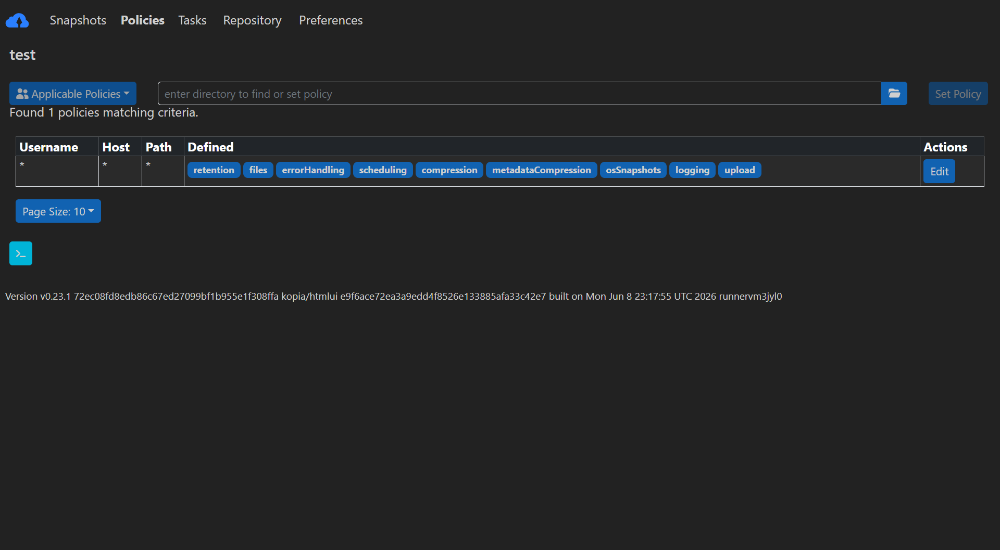

### 5.2 添加第一个要备份的文件夹

**1.**  在资源管理器里打开要备份的文件夹，点一下地址栏，复制完整路径（例如 `D:\照片`）。

**2.**  回到 KopiaUI，点 **Policies** 标签。

**3.**  把路径粘贴到 **enter directory to find or set policy** 输入框里。

**4.**  点 **Set Policy**。右侧或下方会展开策略编辑器（**Policy Editor**）。

**5.**  先别改任何东西，直接点最下方的 **Save Policy**。这样就已经完成「把这个文件夹加入备份」了。

建议先从**一个最有价值的文件夹**开始，例如照片或文档。跑通、确认成功之后，再逐个添加其他文件夹。

> ⚠️ **路径要写完整**
>
> - 必须从盘符开始，例如 `D:\照片`，不能只写「照片」或 `..\照片`。
> - 网络盘要用映射后的盘符，例如 `Z:\共享照片`，不要填 `\\NAS\照片` 这种 UNC 路径（可能可用但不稳定）。
> - 路径末尾不要加多余的反斜杠。

### 5.3 策略编辑器：十个折叠区

策略编辑器比较长，所有设置分成 10 个可折叠的区域。**新手只需要动其中三个**，其余保持默认即可。

| **折叠区（英文原文）** | **中文** | **新手要不要动** |
|---|---|---|
| **Snapshot Retention** | 快照保留 | 要动。决定旧版本留多久（见 5.5）。 |
| **Files** | 文件与忽略规则 | 按需。排除缓存、临时文件时用（见 5.6）。 |
| **Error Handling** | 错误处理 | 不用动。默认遇到错误会跳过并继续。 |
| **Compression** | 压缩 | 建议动。默认不压缩，选一个算法能省空间（见 5.7）。 |
| **Scheduling** | 调度 | **必须动**。决定多久自动备份一次（见 5.4）。 |
| **Upload** | 上传并行度 | 不用动。电脑卡顿时才需要调低。 |
| **Snapshot Actions** / **Folder Actions** | 快照/目录前后脚本 | 不用动，需要写脚本，新手跳过。 |
| **Logging** | 日志详细度 | 不用动。 |
| **Other** | 其他 | 不用动。里面有 JSON 预览，适合排查问题。 |

*表 18  策略编辑器的十个折叠区*

编辑器里每个设置都分两列：

- **Defined**：你为这个文件夹设置的值，可以直接编辑。
- **Effective**：实际生效的值。没设置时显示 **inherit from parent**（继承自上一层），并注明来源，例如  **(Defined by this policy)**  或 **Defined by &lt;某策略名&gt;** 。

> 💡 **继承是怎么回事**
>
> Kopia 的策略分四级：global（全局）→ @host（整台电脑）→ user@host（某用户）→ 具体目录。越具体越优先。下层没设置的项自动用上层的值，所以大部分项留空（inherit）才是正确做法。

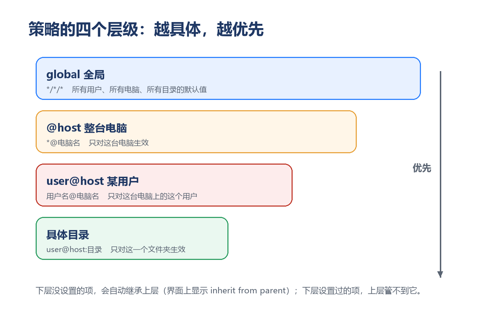

### 5.4 Scheduling：多久自动备份一次

展开 **Scheduling** 区。最重要的字段是 **Snapshot Frequency**（快照频率）：

| **选项（英文原文）** | **中文** | **适合谁** |
|---|---|---|
| **(none)** | 不自动备份 | 只想手动点 **Snapshot Now** 的人。 |
| **every 10 / 15 / 20 / 30 minutes** | 每 10/15/20/30 分钟 | 文件变化非常频繁的人；快照很轻，但没必要这么密。 |
| **every hour** | 每小时 | **推荐大多数家庭用户。** |
| **every 3 / 6 / 12 hours** | 每 3/6/12 小时 | 笔记本、资料盘、不常改动的目录。 |

*表 19  快照频率选项*

同一区里还有几个字段：

| **字段（英文原文）** | **作用** | **新手怎么填** |
|---|---|---|
| **Times Of Day** | 在这些时间点也拍一次快照（24 小时制，可填多个，如 `17:00,22:00`） | 留空。想每天固定时间备份可填 `22:00`；和 Snapshot Frequency 同时设置时两者都会生效。 |
| **Cron Expressions** | 用 cron 表达式精确控制 | 留空。懂 Linux 的人再用。 |
| **Run Missed Snapshots on Startup** | 开机时补跑错过的快照（只对 Times Of Day / Cron 有效） | 保持默认（默认开启）。按固定间隔的备份错过不补拍，只等下一个间隔。 |
| **Manual Snapshots Only** | 只允许手动备份 | 不勾，除非你不想让它自动跑。 |
| **Upcoming Snapshots** | 只读，显示接下来几次计划时间 | 不用管，用来核对设置是否生效。 |

*表 20  Scheduling 区其他字段*

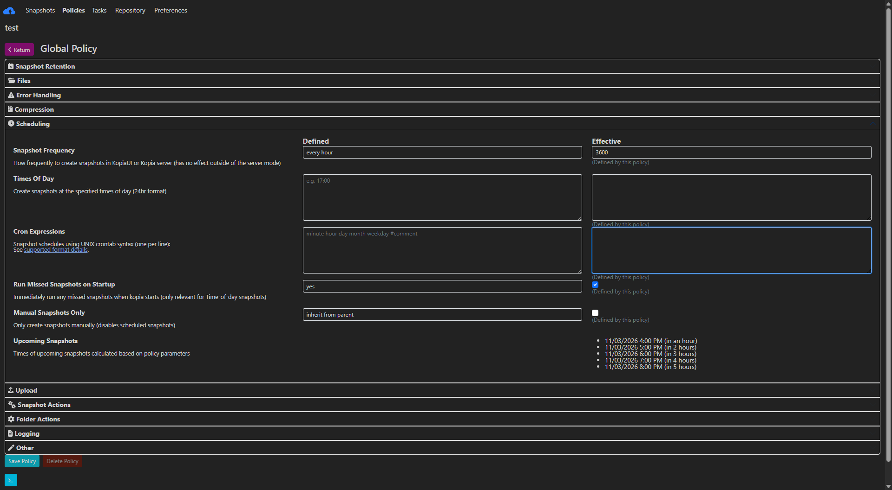

### 5.5 Snapshot Retention：旧版本留多久

展开 **Snapshot Retention** 区。这里的数字决定「每一档时间粒度保留多少个快照」，Kopia 会自动清理超出范围的旧快照。

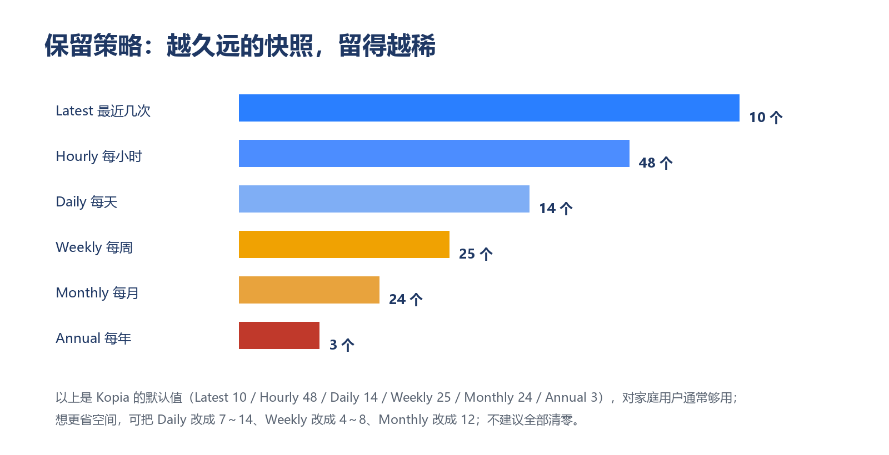

| **字段（英文原文）** | **默认值** | **含义与建议** |
|---|---|---|
| **Latest Snapshots** | 10 | 最近 10 个快照一定保留。保持 10 即可。 |
| **Hourly** | 48 | 每小时档约 2 天。保持默认。 |
| **Daily** | 7 | 每天档约 1 周。**建议 7**；想留两周可改 14。 |
| **Weekly** | 4 | 每周档约 1 个月。**建议 4**；想留久可改 8～12。 |
| **Monthly** | 24 | 每月档约 2 年。**建议 12～24**。 |
| **Annual** | 3 | 每年档保留 3 个。重要资料建议保持默认。 |
| **Ignore Identical Snapshots** | 不勾（默认） | 勾上会少存时间点，新手不建议动。 |

*表 21  保留策略字段（默认值来自 Kopia 全局策略）*

> ⚠️ **数字不要填 0**
>
> 把某一档改成 0，等于不保留这一档的快照（例如 Daily 填 0，就只剩最近几小时和更早的周/月版本，中间的空档找不回来）。只填你需要的档位，其余保持默认。

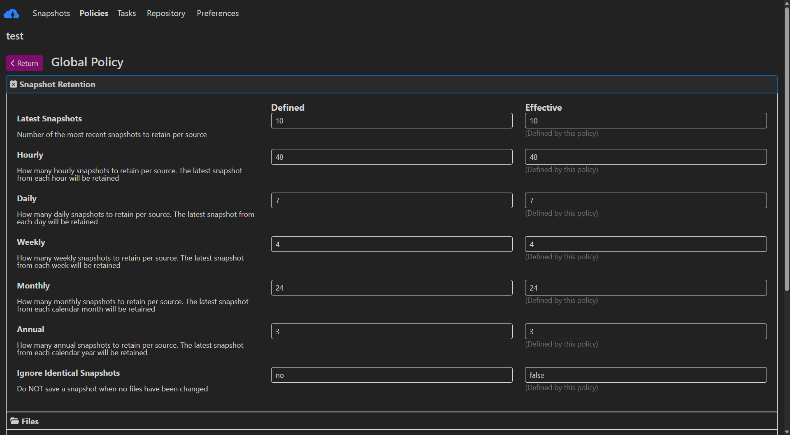

### 5.6 Files：排除不需要备份的内容

默认设置已经会跳过系统缓存。只有当你备份的目录里混有大量临时文件、缓存或超大文件时，才需要动这一区。

| **字段（英文原文）** | **作用** | **示例 / 建议** |
|---|---|---|
| **Ignore Files** | 忽略指定文件或目录（每行一条规则） | 例如 `*.tmp`、`/cache/`、`**/node_modules`。规则支持通配符，`/` 开头表示相对备份根目录。 |
| **Ignore Rule Files** | 从 .kopiaignore 文件读取规则 | 在文件夹里放一个 `.kopiaignore`，写法类似 .gitignore。留空即可。 |
| **Ignore Rules From Parent Directories** | 勾选后不再沿用上级目录的忽略规则 | 一般保持不勾（默认）；只有想完全不用上级目录的配置时才勾。 |
| **Ignore Well-Known Cache Directories** | 自动忽略常见的缓存目录 | **建议保持勾选**。 |
| **Ignore Files larger than** | 超过指定字节数的文件不备份 | 留空。要设的话单位是字节，例如 1 GB = `1073741824`。 |
| **Scan only one filesystem** | 不跨磁盘/挂载点扫描 | 保持默认。 |

*表 22  Files 区的忽略选项*

> 💡 **忽略规则写在哪**
>
> 规则以备份根目录为参照。比如备份 `D:\照片`，规则 `/2020/` 表示忽略 `D:\照片\2020` 整个目录；规则 `*.raw` 会忽略所有层级的 .raw 文件。

### 5.7 Compression：压缩（默认是关的）

这是最容易被忽略的一处：**Kopia 默认不压缩**。想省空间，必须在策略里主动选一个压缩算法。

**1.**  展开 **Compression** 区。

**2.**  点 **Compression Algorithm** 下拉，选一个名字后面带  **(RECOMMENDED)**  的算法。

**3.**  新手直接选 **zstd** 或 **pgzip**：前者压缩率高，后者速度均衡。

**4.**  如果备份的是视频、图片等已经压过的文件，在 **Never Compress Extensions** 里加上 `.mp4`、`.jpg`、`.zip` 等扩展名（每行一个）。

**5.**  保存策略。

| **字段（英文原文）** | **作用** | **新手建议** |
|---|---|---|
| **Compression Algorithm** | 压缩算法，首项是  **(none)** （不压缩） | 选 **zstd**（推荐）或 **pgzip**。 |
| **Minimum File Size** / **Max File Size** | 只压缩大于/小于指定字节数的文件 | 留空，表示不限制。 |
| **Only Compress Extensions** | 只压缩这些扩展名 | 留空。除非你只想压文本类文件。 |
| **Never Compress Extensions** | 永不压缩这些扩展名 | 可填 `.mp4`、`.jpg`、`.png`、`.zip`、`.7z`、`.rar`。 |

*表 23  Compression 区字段*

> ⚠️ **压缩只对新内容生效**
>
> 改压缩算法不会重新压缩已经上传的文件。想让旧文件也压缩，只能删掉旧快照重备份（不推荐）。所以最好在第一次备份前就设置好。

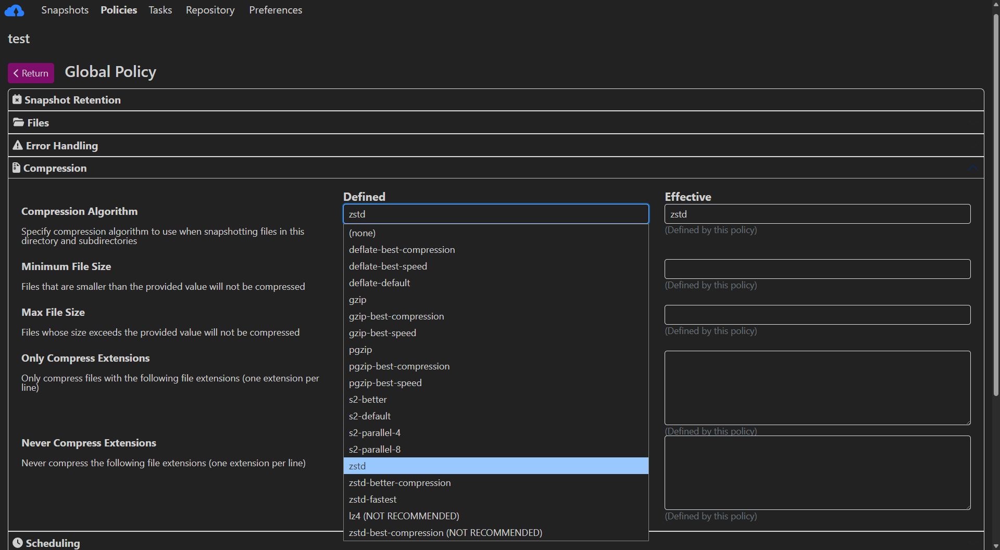

### 5.8 其余折叠区（知道存在即可）

**Error Handling** 控制遇到坏文件时是否跳过；**Upload** 控制并行度（电脑卡顿才需要调低）；**Snapshot Actions / Folder Actions** 是快照前后执行的脚本；**Logging** 控制日志详细度；**Other** 里的 **Disable Parent Policy Evaluation** 会切断继承、慎用，**JSON Representation** 是只读预览，可核对最终生效值。这些新手都不用动。

### 5.9 保存并检查

**1.**  点编辑器最下方的 **Save Policy**。

**2.**  回到策略列表，应该能看到刚才的目录出现在表格里，**Defined** 列会显示你改过哪些项。

**3.**  如果提示 **Error saving policy**，多半是路径不存在、没有权限，或仓库连接已断开；按提示检查后重试。

**4.**  添加更多目录：重复 5.2 的步骤即可。每个目录都可以有不同设置。

| **需求** | **怎么做** |
|---|---|
| 只想临时备份一次某个目录 | 在策略里勾 **Manual Snapshots Only**，以后需要时点 **Snapshot Now**。 |
| 改全局默认值（影响所有目录） | Policies 页下拉选 **Global Policy**，再点 **Set Policy** 编辑。新手慎用，容易一次影响所有备份。 |
| 删除某个目录的策略 | 列表里点 **Edit** → 底部 **Delete Policy**。注意：删策略不等于删快照，历史快照仍在。 |

*表 24  策略相关的常见需求*

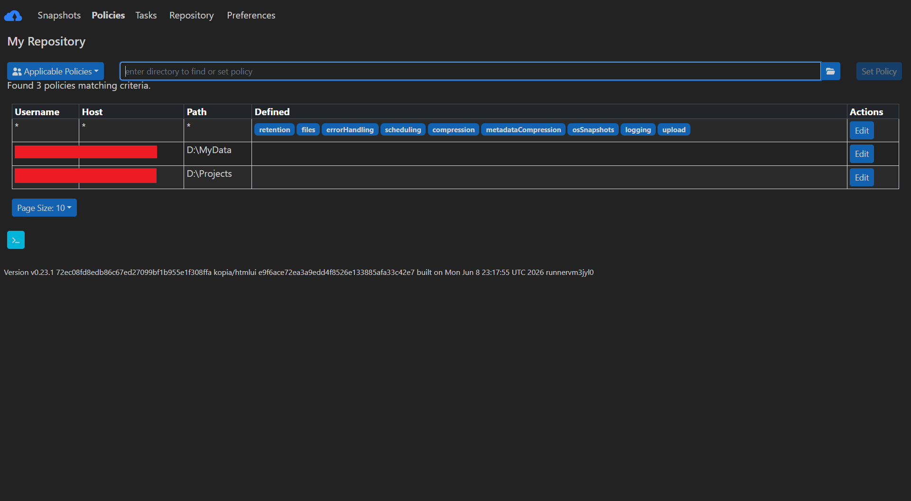

## 第 6 章  第一次备份与确认成功

策略保存后，备份会按计划自动进行。但第一次最好**手动跑一遍**，亲眼确认它是成功的——否则你可能几周后才发现什么都没备上。

### 6.1 立刻手动跑一次

有两种入口，效果一样：

| **入口** | **操作** | **适合** |
|---|---|---|
| Snapshots 页 | 找到你的目录行，点 **Snapshot Now**。 | **最常用**。目录已经在策略里时用它。 |
| New Snapshot 页 | 点右上角 **New Snapshot**，输入路径后点 **Snapshot Now**；旁边的 **Estimate** 可以先估算大小。 | 临时备份一个新目录，或想先看估算。 |

*表 25  手动备份的两个入口*

第一次备份要把所有文件读一遍并上传，**耗时取决于文件总量和仓库位置**：本地硬盘通常几十分钟内完成，移动硬盘或网络盘会更久。建议插上电源、设置成不自动休眠，一次跑完。

> ℹ️ **Estimate 是什么**
>
> **Estimate** 只做估算，不会真的备份。它会告诉你大约有多少文件、多少数据量需要上传，适合在正式备份前评估耗时和空间。

### 6.2 看进度

开始后，Snapshots 页对应行会变成运行状态：**Pending**（排队中）→ 上传时显示已处理的字节数和 **Details** 链接；点 **Details** 或去 **Tasks** 页能看到详细进度。Tasks 页的 **Status** 下拉可以筛 **Running** / **Failed**；任务进行中时，顶部 **Tasks** 标签后面会显示数字，例如 **Tasks (1)** 。

### 6.3 怎么算成功

第一次备份完成后，回到 **Snapshots** 页确认这几项：

| **检查点** | **成功的样子** |
|---|---|
| 最后备份时间 | **Last Snapshot** 列显示刚刚的时间（例如 `2 minutes ago`）。 |
| 大小 | **Size** 列显示一个合理的大小（和原文件夹大致相当）。 |
| 下次备份 | **Next Snapshot** 列显示下一次计划时间；如果显示 **paused** 或 **overdue**，说明设置或电脑状态有问题（见 6.6）。 |
| 历史记录 | 点 **Path** 列进入快照历史，能看到至少一条快照，并带有 **latest-**  的 Retention 徽标。 |
| 任务状态 | **Tasks** 页里该任务状态为完成（不是 Failed）。 |

*表 26  备份成功的五个标志*

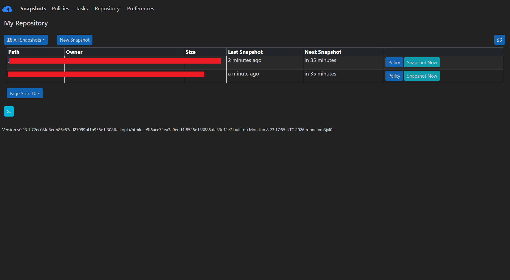

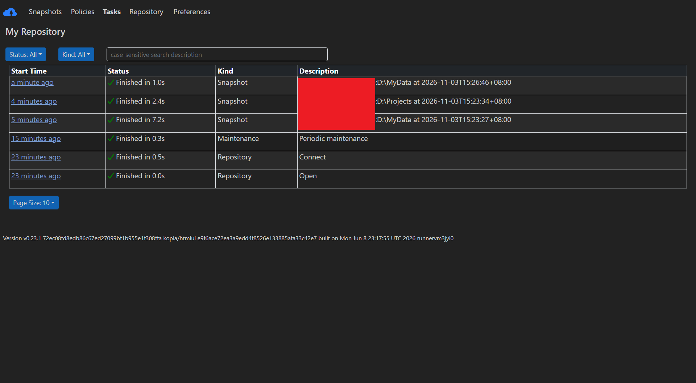

### 6.4 核对内容（很重要）

光看时间不够。点 Path 进入快照历史，再点 **Start time** 列的时间，就能浏览这次快照里的文件和目录结构。确认你关心的文件夹都在、文件数量差不多，就说明备份内容正确。这一步其实就是第 8 章「浏览快照」的入口，现在顺手点一下，熟悉界面。

### 6.5 失败了怎么办

| **现象 / 报错** | **常见原因** | **怎么办** |
|---|---|---|
| 找不到路径 / cannot open directory | 文件夹被改名、移动、删除，或移动硬盘没插 | 插好硬盘、恢复路径；或修改策略里的路径。 |
| 权限不足 / access denied | 目标目录需要管理员权限，或被杀毒软件拦截 | 换普通用户目录备份；把 Kopia 加入杀毒软件白名单。 |
| 文件被占用 / 读取失败 | 文件正被程序独占写入 | 关闭对应程序；或开启 **Ignore File Errors** 让它跳过。 |
| 仓库写入失败 | 移动硬盘掉线、网络盘断开、磁盘满 | 检查连接和剩余空间，然后重试。 |
| 任务卡在 Running 很久 | 文件太多、网速慢、硬盘休眠 | 先等待；仍不动就取消任务重试，并检查磁盘。 |

*表 27  第一次备份常见失败原因*

> 💡 **记下报错原文**
>
> Kopia 的错误信息通常很具体。把 **Tasks** 页里失败的 Description 或弹窗原文复制下来，能大大提高搜索/提问的效率。

### 6.6 之后的自动备份

第一次成功之后，你就不用每天点按钮了。Snapshots 页的 **Next Snapshot** 会显示下一次计划时间，到点自动运行。

| **你看到的状态** | **含义** | **怎么办** |
|---|---|---|
| 正常时间 | 已排好下一次备份 | 什么都不用做。 |
| **overdue** | 早该备份了但一直没成功（电脑关机、仓库没连上） | 检查电脑/硬盘/网络；确认托盘里 KopiaUI 在运行（打开 **Launch At Startup**）。 |
| **paused** | 策略里勾了 **Manual Snapshots Only**，不会自动跑 | 改为自动频率，或继续手动备份。 |
| 长时间没有新快照 | KopiaUI 被 Quit、托盘没启动、仓库连接失效 | 检查托盘图标；重新打开 KopiaUI；确认仓库已连接。 |

*表 28  Snapshots 页状态怎么看*

Kopia 只上传变化过的内容，所以第二次、第三次备份常常只要几秒，这是正常的。（如果手动勾了 **Ignore Identical Snapshots**，内容完全没变时还会跳过、不生成新快照。）

## 第 7 章  日常怎么用

配置好之后，Kopia 基本是「隐形」的。这一章告诉你平时需要看什么、不用看什么。

### 7.1 每天：什么都不用做

- 保持托盘里有 Kopia 图标，到点自动备份。
- 关闭主窗口不会停止备份；只有托盘菜单里的 **Quit** 才会真正退出。
- **Notifications** 设为 **Enabled** 或 **Warnings And Errors**，出错时你会收到 Windows 通知。
- 备份到移动硬盘的，**记得定期插上硬盘**让它跑一次；长期不插，快照会显示 **overdue**。

### 7.2 每周：花一分钟看一眼

**1.**  双击托盘图标打开主窗口，点 **Snapshots**。

**2.**  看每个目录的 **Last Snapshot** 是不是最近的时间、**Next Snapshot** 是否正常。

**3.**  如果某行显示 **overdue** 或 **paused**，对照表 28 处理。

**4.**  点列表右上角的同步按钮（悬停提示 **Synchronize**）可以立即刷新状态。

### 7.3 每月：做三件小事

| **要做的事** | **怎么做** |
|---|---|
| 看一眼失败任务 | **Tasks** 页 → 把 **Status** 筛选为 **Failed**，有失败就点开看原因。 |
| 看一眼仓库空间 | 在资源管理器里右键仓库文件夹 → **属性**，看占用；快满了就减少保留数量，或换更大的硬盘。 |
| 检查更新 | 托盘菜单看是否有 **Update Available**；有就更新。 |
| （可选）改外观 | **Preferences** 页的 **Appearance** 标签：**Theme** 可选 light / dark / pastel / ocean，**Appearance** 可选 small / medium / large，**Byte representation** 可选 Base-2 (KiB…) 或 Base-10 (KB…)。 |

*表 29  每月检查清单*

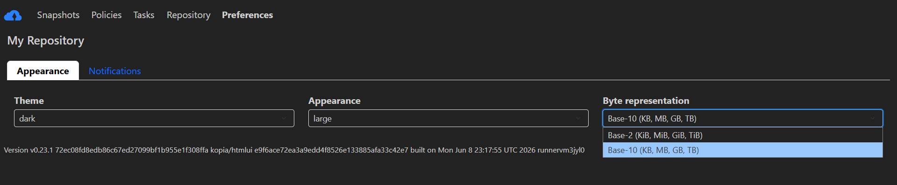

### 7.4 多台电脑共用一个仓库

家里有两台电脑时，可以让它们备份到**同一个仓库**。这样相同的内容（比如同一批照片）在仓库里只存一份，很省空间。

**1.**  在第二台电脑上安装 KopiaUI。

**2.**  按第 4.7 节的方法，用同一个仓库位置和**同一个密码**连接（注意是 Connect，不是 Create）。

**3.**  在第二台电脑的 Policies 页，把它自己的文件夹加入策略。

**4.**  两台电脑的快照会并列显示。Snapshots 页左上角的 owner 下拉可切换 **Local Snapshots** / **All Snapshots**，看全部电脑的备份。

> ⚠️ **同一个快照不能存进两个仓库**
>
> 如果你想同时备份到移动硬盘和云端，需要分别建两个仓库，并给同一个文件夹在两处各建一份策略。KopiaUI 可以同时连接多个仓库，用托盘菜单切换即可。

### 7.5 一台电脑上的推荐设置清单

| **设置项** | **推荐值** | **在哪一章** |
|---|---|---|
| 仓库位置 | 移动硬盘 / 另一块磁盘 | 2.1 节 |
| 备份目录 | 桌面、文档、图片、聊天文件、代码等 | 2.2 节 |
| Snapshot Frequency | **every hour** | 5.4 节 |
| Daily / Weekly / Monthly 保留 | 7 / 4 / 24（默认即可） | 5.5 节 |
| Compression Algorithm | **zstd**（或带 RECOMMENDED 的） | 5.7 节 |
| Ignore Well-Known Cache Directories | **勾选**（默认） | 5.6 节 |
| Launch At Startup | **勾选** | 3.4 节 |
| Notifications | Enabled 或 Warnings And Errors | 3.4 节 |

*表 30  推荐设置一览*

## 第 8 章  找回文件：三种恢复方式

这一章是备份软件真正的价值所在。Kopia 提供三种恢复方式，先看图，再按场景选一种。

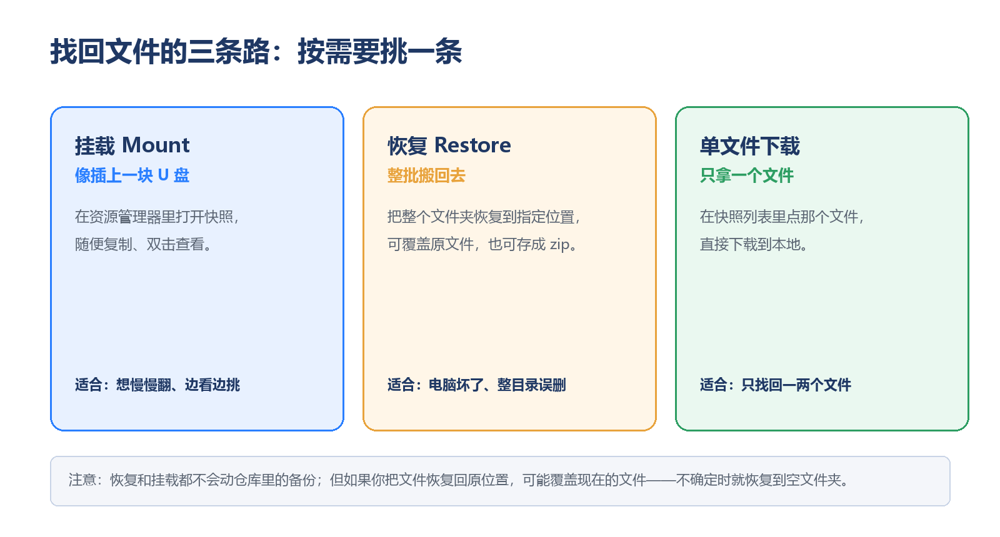

### 8.1 恢复前的三条原则

> 🚨 **先停手，再恢复**
>
> - **先不要把新文件写进原来的位置**，避免覆盖还能恢复的数据。
> - **优先恢复到另一个文件夹**（例如桌面新建的「恢复」文件夹），确认内容无误后，再手动拷回原位。
> - 恢复前确认仓库所在硬盘/网络已连上，并留出至少和目标文件同样大的空闲空间。

### 8.2 方式一：浏览快照，下载单个文件

适合：只丢了几个文件，或者想先看看旧版本长什么样。

**1.**  点 **Snapshots** 标签，找到对应目录，点 **Path** 列进入快照历史页。

**2.**  历史页表格里，点 **Start time** 列的时间，进入那次快照的目录浏览页。

**3.**  像用资源管理器一样点进文件夹，找到文件后点它下载；也可以点 **Restore Files & Directories** 跳去整批恢复。

历史页还能做这些事：**Show N individual snapshots** 复选框可以展开/收起全部快照；勾选后 **Delete Selected (n)**  批量删除；**Pin Snapshot**（固定快照，默认名 `do-not-delete`）可以防止某个重要版本被保留策略自动清理。

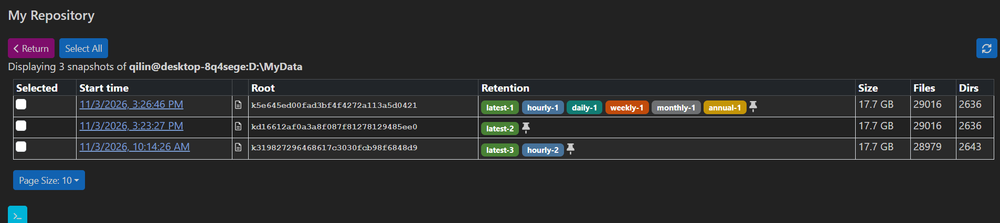

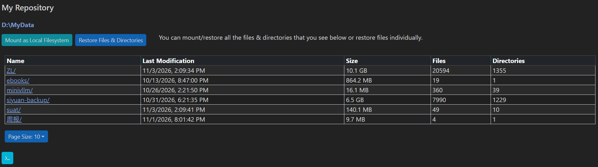

### 8.3 方式二：Restore，整批恢复到指定位置

适合：整个文件夹丢了、换电脑、或者要恢复到某个新位置。这是最稳妥的方式。

**1.**  在快照浏览页点 **Restore Files & Directories**，进入 **Restore** 页面。

**2.**  **Destination** 填恢复目标，例如 `D:\恢复\照片`。目标是**空文件夹或新文件夹**最安全。

**3.**  其余选项保持默认，点 **Begin Restore**。

**4.**  点出现的 **Go To Restore Task** 链接，或去 **Tasks** 页看进度；完成后到目标文件夹检查文件。

| **字段（英文原文）** | **默认** | **新手怎么处理** |
|---|---|---|
| **Destination** | 必填 | 支持本地路径；也可以填 `.zip` / `.tar` 结尾的路径，直接恢复成一个压缩包。 |
| **Skip previously restored files and symlinks** | 勾选 | 保持勾选。恢复中断后重跑时，已恢复的文件会跳过。 |
| **Continue on Errors** | 未勾 | 文件多、可能有个别坏文件时，可以勾上，避免整体中断。 |
| **Restore File Ownership / Permissions / Modification Time** | 勾选 | 保持默认勾选：保留原始所有权/权限/修改时间，家庭用户通常希望如此。 |
| **Overwrite Files / Directories / Symbolic Links** | 未勾 | **恢复到新文件夹时不需要勾**；目标已有同名文件时默认不覆盖（跳过或报错），确认要覆盖时才勾，风险较高。 |
| **Write files atomically** | 未勾 | 可勾选，降低恢复过程中断电导致文件不完整的风险。 |
| **Disable ZIP compression** | 勾选 | 恢复到 zip 时保持勾选（更快）。 |
| **Shallow Restore At Depth** / **Minimal File Size…** | 1000 / 0 | 保持默认，用于超大目录的浅层恢复，新手用不到。 |

*表 31  Restore 页面的选项*

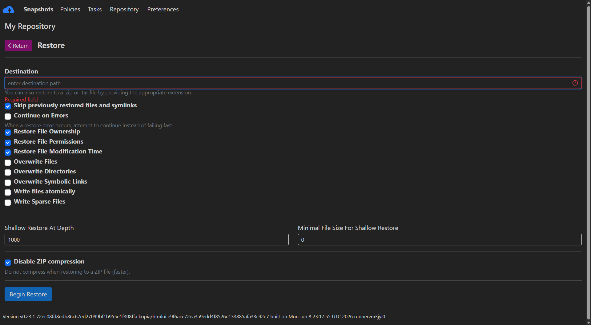

### 8.4 方式三：Mount，把快照挂载成一块磁盘

适合：想用资源管理器慢慢翻、比较多个版本，或者一次挑很多文件复制出来。挂载后像一块**只读的 U 盘**，不会改动仓库。

**1.**  在快照目录浏览页点 **Mount as Local Filesystem**。

**2.**  Windows 上 Kopia 会通过 WebDAV 把它映射成一个盘符（例如 `Z:`）。挂载成功后按钮会变成 **Unmount**，并出现 **Browse** 按钮和挂载路径输入框。

**3.**  点 **Browse** 打开资源管理器，找到那个盘符，像普通文件夹一样复制需要的文件出来。

**4.**  用完点 **Unmount** 卸载。也可以在资源管理器里右键断开，或命令行 `net use Z: /delete`。

> ⚠️ **挂载失败（常见 status 2）**
>
> Windows 的挂载依赖 **WebClient** 服务。KopiaUI 失败时通常**不会弹出错误提示**，表现为点了没反应、或资源管理器里看不到盘符。这时用管理员身份打开命令提示符，依次执行 `sc config WebClient start= demand` 和 `sc start WebClient`，再重试。

挂载是**只读**的：不能往里面写文件，也不会因为误操作破坏快照。适合挑文件，不适合大批量恢复——那种情况用 8.3 的 Restore 更快。

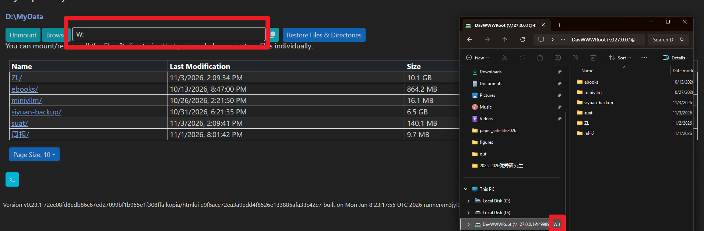

### 8.5 三种方式怎么选

| **你的情况** | **推荐方式** |
|---|---|
| 只丢了一两个文件 | 方式一：浏览快照，下载/单个恢复。 |
| 整个文件夹丢失、要换电脑迁移 | 方式二：Restore 到新位置。 |
| 想逐个比较版本、挑很多文件 | 方式三：Mount 后像磁盘一样浏览复制。 |
| 磁盘空间不够、只想拿回少量文件 | 方式一或方式三（挂载不占额外空间）。 |
| 要把备份交给别人 / 存档 | 方式二，恢复成 `.zip` 文件。 |

*表 32  按场景选恢复方式*

### 8.6 每季度做一次恢复演练

备份最怕的是「以为有，其实用不了」。建议每三个月做一次小演练，只需要两分钟：

**1.**  随便挑一个最近改过的小文件。

**2.**  按 8.2 的方式浏览快照，把它的旧版本恢复到桌面上的测试文件夹。

**3.**  打开确认内容正确、能正常使用。

**4.**  删掉测试文件。演练结束。

如果这一步能成功，说明仓库连接、密码和软件都正常；如果失败，趁数据还没真丢，赶紧排查。

## 第 9 章  英文界面速查表

这一章把界面上会遇到的英文集中翻译一遍。不用背，遇到看不懂的地方翻到这里对照即可。

### 9.1 顶部导航与通用按钮

| **英文原文** | **中文** | **出现在哪 / 作用** |
|---|---|---|
| **Snapshots** / **Policies** / **Tasks** / **Repository** / **Preferences** | 快照 / 策略 / 任务 / 仓库 / 偏好设置 | 顶部五个标签。有任务运行时 Tasks 显示 **Tasks (n)** 。 |
| **Save Policy** / **Delete Policy** | 保存策略 / 删除策略 | 策略编辑器底部按钮；删策略不删历史快照。 |
| **Synchronize** | 同步/刷新 | 列表右上角的刷新图标按钮。 |
| **Details** | 详情 | 任务行里的链接，查看进度或日志。 |
| **Edit** | 编辑 | 策略列表 Actions 列的按钮。 |
| **Cancel** / **Quit** | 取消 / 退出 | 弹窗的取消按钮；托盘菜单的退出。 |

*表 33  通用按钮与导航*

### 9.2 Snapshots 页与快照历史

| **英文原文** | **中文** | **说明** |
|---|---|---|
| **New Snapshot** / **Snapshot Now** | 新建快照 / 立即备份 | 前者打开输入路径的页面；后者立即跑一次快照。 |
| **Policy** | 策略 | 列表行按钮，跳到该目录的策略。 |
| **Path / Owner / Size / Last Snapshot / Next Snapshot** | 路径 / 所有者 / 大小 / 上次备份 / 下次备份 | 列表列名；Owner 形如 `user@host`。 |
| **最后一列（没有列名）** | 操作 / 状态 | 空闲时显示 **Policy** / **Snapshot Now**；运行中显示 **Pending** 或上传进度 + **Details**。 |
| **Pending / paused / overdue** | 排队中 / 已暂停 / 已逾期 | 状态文字，见 6.6。 |
| **Displaying N snapshots of user@host:path** | 显示某目录的 N 个快照 | 快照历史页标题区文案。 |
| **Show N individual snapshots** | 展开 N 个单独快照 | 复选框，展开/收起全部快照行。 |
| **Select All / Deselect All / Delete Selected (n)** | 全选 / 取消全选 / 删除选中（n） | 批量操作；删的是快照记录，不动原文件。 |
| **Delete Snapshot Source** | 删除快照源 | 连同该目录的全部快照一起删除，慎用。 |
| **Start time** | 开始时间 | 点它进入那次快照的目录浏览页。 |
| **Root / Retention / Files / Dirs** | 根路径 / 保留档位 / 文件数 / 目录数 | Retention 徽标如 `latest-1`、`daily-3`。 |
| **Confirm Delete** | 确认删除 | 删除确认弹窗；勾 **Wipe all snapshots and the policy for this source.**  会连策略一起抹掉。 |
| **Pin Snapshot / Name of the pin** | 固定快照 / 固定名称 | 给快照命名（默认 `do-not-delete`），防止被保留策略清理。 |
| **Snapshot Description** | 快照描述 | 给某个快照加备注。 |

*表 34  Snapshots 与快照历史相关*

### 9.3 目录浏览与恢复

| **英文原文** | **中文** | **说明** |
|---|---|---|
| **Mount as Local Filesystem** / **Unmount** / **Browse** | 挂载为本地磁盘 / 卸载 / 浏览 | 把快照挂载成只读磁盘；挂载后出现后两个按钮。 |
| **Restore Files & Directories** | 恢复文件和目录 | 进入 Restore 页面。 |
| **Destination** | 恢复目标 | 必填；可填文件夹，或 `.zip` / `.tar` 文件路径。 |
| **Skip previously restored files and symlinks** | 跳过已恢复的文件 | 默认勾选。 |
| **Continue on Errors** | 出错时继续 | 个别文件失败不中断整体。 |
| **Restore File Ownership / Permissions / Modification Time** | 恢复所有权 / 权限 / 修改时间 | 默认勾选，保留原始属性。 |
| **Overwrite Files / Directories / Symbolic Links** | 覆盖文件 / 目录 / 符号链接 | 恢复到原位时才需要，风险高。 |
| **Write files atomically** / **Write Sparse Files** | 原子写入 / 写入稀疏文件 | 高级选项，一般不用。 |
| **Disable ZIP compression** | 禁用 ZIP 压缩 | 恢复到 zip 时默认勾选，更快。 |
| **Shallow Restore At Depth** / **Minimal File Size For Shallow Restore** | 浅层恢复深度 / 最小文件大小 | 默认 1000 / 0，新手不用改。 |
| **Begin Restore** / **Go To Restore Task** | 开始恢复 / 前往恢复任务 | 主按钮；开始后出现任务链接。 |

*表 35  恢复相关*

### 9.4 Policies 与策略编辑器

| **英文原文** | **中文** | **说明** |
|---|---|---|
| **Applicable Policies** | 适用的策略 | 下拉默认项。 |
| **Local Path Policies / All Policies / Global Policy / Per-User Policies / Per-Host Policies** | 本机路径 / 全部 / 全局 / 按用户 / 按主机 | 策略层级，越具体越优先。 |
| **enter directory to find or set policy** / **Set Policy** | 输入目录 / 设置策略 | 路径输入框与按钮。 |
| **Username / Host / Path / Defined / Actions** | 用户名 / 主机 / 路径 / 已定义项 / 操作 | 策略列表的列。 |
| **Found N policies matching criteria.**  / **No policies found.** | 找到 N 条策略 / 没有找到策略 | 列表提示文案。 |
| **Defined / Effective** | 已设置 / 实际生效 | 编辑器两列表头。 |
| **inherit from parent** | 继承自上层 | 下拉未设置时的占位文字。 |
| **Snapshot Retention** | 快照保留 | Latest / Hourly / Daily / Weekly / Monthly / Annual / Ignore Identical Snapshots。 |
| **Files** | 文件与忽略 | Ignore Files / Ignore Rule Files / Ignore Well-Known Cache Directories / Ignore Files larger than。 |
| **Compression** | 压缩 | Compression Algorithm / Minimum File Size / Max File Size / Only / Never Compress Extensions。 |
| **Scheduling** | 调度 | Snapshot Frequency / Times Of Day / Cron Expressions / Run Missed Snapshots on Startup / Manual Snapshots Only。 |
| **Upload** | 上传 | Maximum Parallel Snapshots / Maximum Parallel File Reads。 |
| **Error Handling** | 错误处理 | Ignore Directory / File Errors / Ignore Unknown Directory Entries。 |
| **Other** | 其他 | Disable Parent Policy Evaluation / JSON Representation。 |

*表 36  Policies 与策略编辑器*

### 9.5 其他页面、向导与托盘

| **英文原文** | **中文** | **说明** |
|---|---|---|
| **Connected To Repository** / **Initializing Repository...** | 已连接到仓库 / 正在初始化 | Repository 页标题与进度提示。 |
| **Update Description** / **Description Is Required** | 更新描述 / 描述不能为空 | 保存仓库名字。 |
| **Disconnect** / **Repository is read-only** | 断开连接 / 仓库为只读 | 断开不会删数据；只读时会有徽标。 |
| **Config File / Provider / Encryption Algorithm / Hash Algorithm / Splitter Algorithm / Repository Format / Error Correction / Internal Compression / Connected as:** | 配置信息 | Repository 页的只读字段。 |
| **Status: All / Running / Failed** | 状态筛选 | Tasks 页下拉；另有 **Kind** 筛选与搜索框。 |
| **Start Time / Status / Kind / Description** | 开始时间 / 状态 / 类型 / 描述 | Tasks 表格列。 |
| **Appearance / Notifications** | 外观 / 通知 | Preferences 的两个标签。 |
| **Theme / Appearance / Byte representation** | 主题 / 显示大小 / 容量单位 | light/dark/pastel/ocean；small/medium/large；Base-2/Base-10。 |
| **Select Storage Type** / **Storage Configuration** / **Directory Path** | 选择存储类型 / 存储配置 / 目录路径 | 建仓库向导三步。 |
| **Create New Repository** / **Connect To Repository** | 创建新仓库 / 连接已有仓库 | 目标位置为空/已有仓库时分别出现。 |
| **Repository Password** / **Confirm Repository Password** | 仓库密码 / 确认密码 | 两遍输入；不一致会提示 **Passwords don't match**。 |
| **Show Advanced Options** / **Encryption / Hash Algorithm / Splitter / Repository Format / Error Correction** | 高级选项 | 保持默认。 |
| **Connect As** / **Repository Description** / **Connect in read-only mode** | 连接身份 / 仓库描述 / 只读连接 | 连接已有仓库时填写。 |
| **Connect To Another Repository...** | 连接另一个仓库 | 托盘菜单；可同时连多个仓库。 |
| **Launch At Startup** | 开机自启 | 托盘菜单勾选项。 |
| **Notifications: Enabled / Warnings And Errors / Disabled** | 通知：全部 / 仅警告和错误 / 关闭 | 控制 Windows 通知。 |
| **Check For Updates Now** / **Update Available** / **Download And Install...** | 检查更新 / 有新版本 / 下载并安装 | 托盘菜单。 |
| **Repository is not connected** | 仓库未连接 | 未连仓库时标签的悬停提示。 |
| **Kopia is running in the background** | Kopia 正在后台运行 | 首次启动托盘气泡。 |

*表 37  其他页面、向导与托盘*

## 第 10 章  设置项红绿灯

这一章回答一个最实际的问题：**哪些设置可以改，哪些改了会出事**。拿不准时回到这里查。

| **灯** | **设置项 / 操作** | **说明与建议** |
|---|---|---|
| 🟢 | **Snapshot Frequency** | 改成 every hour / every 3 hours / (none)，随时可改。 |
| 🟢 | **Retention 各档数字** | 调大更安全；调小后，超出范围的旧快照会在之后的清理中被删除。 |
| 🟢 | **Compression Algorithm** | 选 zstd / pgzip；只影响以后的新内容。 |
| 🟢 | **Ignore Files / Never Compress Extensions** | 随时可加规则。 |
| 🟢 | **Launch At Startup / Notifications** | 托盘菜单里开关。 |
| 🟢 | **Theme / Appearance / Byte representation** | 只改显示，不影响数据。 |
| 🟢 | **Repository Description / Pin Snapshot** | 随时改名；给重要快照加个名字避免被清理。 |
| 🟡 | **Global Policy**（全局策略） | 一改会影响所有目录、所有电脑的默认值。改完检查每个目录的 Effective 列。 |
| 🟡 | **Manual Snapshots Only** | 勾上后不再自动备份，容易忘记。只对临时目录用。 |
| 🟡 | **Times Of Day / Cron Expressions** | 格式填错会报错或让计划不符合预期；用 **Upcoming Snapshots** 核对。 |
| 🟡 | **Ignore Files larger than** | 设得太小会漏备大文件，而且不会提示。尽量留空。 |
| 🟡 | **Maximum Parallel File Reads / Snapshots** | 影响 CPU 与速度；卡顿时把 File Reads 调到 2～4，Parallel Snapshots 保持默认 1。 |
| 🟡 | **Delete Selected (n) / Disconnect** | 删快照不可撤销（重要版本先 **Pin Snapshot**）；断开后不再自动备份但数据不丢。 |
| 🟡 | **Restore 的 Overwrite 系列** | 可能覆盖现有文件；恢复到新文件夹时不要勾。 |
| 🔴 | **Encryption / Hash Algorithm / Splitter / Repository Format / Error Correction** | 创建仓库时定下，之后不能改；改错只能重建仓库、重新备份。 |
| 🔴 | **仓库文件夹里的任何文件** | 仓库由许多加密块文件组成，手动改名、删除、移动会直接损坏备份。 |
| 🔴 | **删除 / 移动整个仓库目录** | 要整目录复制或移动，再在 KopiaUI 里重新 Connect 新路径。 |
| 🔴 | **Wipe all snapshots and the policy for this source. / Delete Snapshot Source** | 会把该源的全部快照（和策略）一起抹掉，无法恢复。 |
| 🔴 | **把密码只存在浏览器/聊天记录里** | 清理浏览器数据或换电脑就丢了密码，仓库永久打不开。 |
| 🔴 | **用 KopiaUI 之外的软件同步/备份仓库目录** | 可能读到写一半的文件；要复制仓库，先退出 KopiaUI 再整目录复制。 |

*表 38  设置项红绿灯*

> 🚨 **一句话总结**
>
> 拿不准的项，保持 **inherit from parent**（继承）就是最安全的选择；只改频率、保留、压缩这三处，已经能满足 99% 的家庭用户。

## 第 11 章  维护、检查与升级

Kopia 的大部分「保养」工作是自动完成的，这一章帮你理解它在背后做什么，避免被任务列表吓到。

### 11.1 维护（Maintenance）是自动的

Kopia 需要定期清理不再被引用的数据块、整理索引。这些动作叫 maintenance，由 Kopia 自动调度：

| **类型** | **默认频率** | **作用** |
|---|---|---|
| **Quick maintenance** | 约每小时 | 整理索引、清理明显无用的块，很快。 |
| **Full maintenance** | 约每 24 小时 | 彻底清理、压缩索引，耗时较长，可能让电脑忙一阵。 |

*表 39  两种维护*

你会在 **Tasks** 页看到 Kind 为维护的任务，这是正常的，不用管。**GUI 里没有手动运行维护的按钮**——不需要，也不建议手动干预。同一时刻只允许一个维护者（maintenance owner），所以多台电脑连同一个仓库时，维护由其中一台负责。

### 11.2 删了快照，为什么空间没马上变小

删除快照只是删掉「索引」，真正占空间的数据块要等 **full maintenance** 运行、且超过安全延迟之后才会被回收。所以删除后空间可能几小时到一天都不变，这是正常的，不要以为删除失败而反复操作。

### 11.3 一致性校验（选学）

Kopia 可以校验仓库中数据块的完整性。**GUI 里没有这个按钮**，只能用命令行（开始菜单搜「命令提示符」，或在 KopiaUI 安装目录找到 kopia.exe）：

`kopia snapshot verify --verify-files-percent=1`

含义是随机抽取 1% 的文件做校验。数据特别重要、又长期不用恢复的人，可以半年跑一次。新手可以跳过。

### 11.4 升级

按第 3.5 节处理即可：托盘菜单看到 **Update Available** 就点 **Download And Install...** 。升级只换软件本体，不会动仓库。

### 11.5 换电脑重装时，需要带走什么

| **要带走** | **不用带走** |
|---|---|
| **仓库本身**（整目录复制到新硬盘） | KopiaUI 安装目录（重新装即可） |
| **仓库密码**（必须记得） | 本机缓存（会自动重建） |
| （可选）原电脑的 `%APPDATA%kopia` 配置目录 | 快照历史（都在仓库里） |

*表 40  迁移时要带什么*

到新电脑上：安装 KopiaUI → 托盘菜单 **Connect To Another Repository...**  → 选同样存储类型、指向仓库目录 → 输入密码。KopiaUI 启动时会自动扫描 `%APPDATA%\kopia\` 下所有 `*.config` 并尝试连接，旧配置指向已不存在的路径时忽略或删除即可。

### 11.6 卸载和迁移仓库

- **卸载 KopiaUI 不会删除仓库**。仓库是普通文件夹，卸载程序不会碰它。
- **迁移仓库**：先退出 KopiaUI（托盘 **Quit**），把整个仓库文件夹复制/移动到新位置，再在新位置 **Connect**。不要只复制一部分文件。
- **移动硬盘换了盘符**：在 KopiaUI 里重新 Connect 新盘符下的仓库即可；旧连接会失效。
- **不要用网盘同步工具实时同步仓库目录**（OneDrive 等）：可能同步到写了一半的文件。要异地备份仓库，请用 Kopia 直接连接云存储，或先退出再整目录复制。

## 第 12 章  12 个新手最容易踩的坑

| **坑** | **为什么是坑** | **怎么办** |
|---|---|---|
| 1. 密码只记在浏览器或脑子里 | 重装系统、清理浏览器、换电脑之后，仓库再也打不开。 | 密码存进密码管理器，并抄一份纸质备份，和备份硬盘分开放。 |
| 2. 仓库放在要备份的同一块硬盘/目录里 | 硬盘坏了数据一起没；放在源目录内部还会自己备份自己，空间暴涨。 | 仓库放另一块盘或移动硬盘；新建专用空文件夹。 |
| 3. 把 Kopia 当网盘同步用 | 以为删了本地云端也删、两台电脑会自动一致，结果不是。 | Kopia 是备份工具：删本地不影响快照；同步需求用专门的同步工具。 |
| 4. 不知道压缩默认是关的 | 备份了几百 GB，才发现仓库比想象中大很多。 | 在 **Compression** 区选 **zstd** 或带 (RECOMMENDED) 的算法；已上传内容不追溯。 |
| 5. 改了 Global Policy | 全局策略是所有目录、所有电脑的默认值，一改全受影响。 | 只改具体目录的策略；确实要改全局时，改完逐个检查 **Effective** 列。 |
| 6. 设了每小时备份，但电脑经常关机 | 快照显示 **overdue**，重要的那几天其实没备份上。 | 打开 **Launch At Startup**；笔记本可改成每 3/6 小时并保持电源连接。 |
| 7. 把整个 C 盘加进备份 | 备份了几十万个系统文件，慢、大、还不断报权限错误。 | 只备份桌面、文档、图片等个人数据；用 **Ignore Files** 排除缓存。 |
| 8. 忽略规则写错位置或格式 | 以为排除了缓存，其实规则没生效，仓库里全是临时文件。 | 规则以备份根目录为参照；`/xxx` 相对根目录，`*.tmp` 匹配所有层级。 |
| 9. 手动改仓库文件夹里的文件 | 把仓库当普通文件夹整理，改名或删掉几个文件，仓库直接损坏。 | 仓库是 Kopia 的私有格式，永远不要手动改动；迁移请整目录复制。 |
| 10. 两台电脑同时跑维护 / 只读还去建快照 | 任务冲突或提示只读，备份失败。 | 只读连接只用来取文件；需要备份的电脑各自用自己的策略，维护由系统协调。 |
| 11. 移动硬盘休眠/被拔出 | 任务失败或显示 **overdue**，但通知被关掉了，没注意到。 | 保持 **Notifications** 开启；移动硬盘设为不休眠；每周看一眼 Snapshots 页。 |
| 12. 恢复时直接覆盖原目录 | 把坏文件或错误版本覆盖到唯一一份好数据上。 | 永远先恢复到新文件夹，确认无误再手动拷回；**Overwrite** 系列默认不要勾。 |

*表 41  12 个新手最容易踩的坑*

## 第 13 章  常见问题 FAQ

按问题类型排列。找不到答案时，可以把英文报错原文发到 Kopia 的 GitHub Discussions 提问。

### Q1　忘记仓库密码了，还能恢复吗？

**A：**  不能。Kopia 是端到端加密，密码只在你本机，官方也没有后门。如果这台电脑还连着仓库，可以用命令行 `kopia repository change-password` 改密码（GUI 不支持）；一旦彻底忘记又无法连接，数据无法恢复。

### Q2　能备份到 OneDrive / Google Drive / 百度网盘吗？

**A：**  Kopia 原生支持对象存储（S3、B2、Azure、GCS）和 WebDAV、SFTP，不直接支持消费级网盘。可以在 **Select Storage Type** 里选 **Rclone Remote**（实验性）间接使用 OneDrive/Google Drive/Dropbox；更稳妥的是用支持 WebDAV 的网盘或对象存储。

### Q3　能备份手机吗？

**A：**  不能直接备份。先把手机照片/文件导到电脑上的文件夹，再让 Kopia 备份那个文件夹。

### Q4　能备份整个 Windows 系统、做到一键还原吗？

**A：**  不能。Kopia 是文件级备份，不是系统镜像工具。系统盘坏了需要重装 Windows，再用 Kopia 恢复个人文件。系统还原请用 Windows 自带功能或专门的镜像工具。

### Q5　备份会不会很占 CPU、让电脑变卡？

**A：**  正常使用几乎无感。首次备份和开启压缩时会占一些 CPU；如果明显卡顿，把 **Maximum Parallel File Reads** 调低（例如 2），或在 **Times Of Day** 限定备份时段。

### Q6　为什么第二次备份只要几秒？

**A：**  因为 Kopia 只处理变化的内容，没变的文件直接跳过；如果勾了 **Ignore Identical Snapshots**，内容完全没变时甚至不会生成新快照。

### Q7　为什么修改了文件，却没看到新快照？

**A：**  检查 **Snapshot Frequency** 是否设成了  **(none)**  或 **Manual Snapshots Only**；也可能是还没到下一个整点。点 **Snapshot Now** 可以立刻生成。

### Q8　Snapshots 页显示 paused / overdue 是什么意思？

**A：paused** ＝策略设了仅手动备份，不会自动跑；**overdue** ＝早该备份却没成功，通常是电脑关机、移动硬盘没插、网络盘掉线。打开 **Launch At Startup** 能让程序开机就运行。

### Q9　仓库能不能放在 NAS 上？

**A：**  可以，在 **Local Directory or NAS** 里填映射后的网络盘路径（如 `Z:\Kopia仓库`）。注意 NAS 关机或休眠时备份会失败，建议让 NAS 定时唤醒。

### Q10　一个文件夹能同时备份到两个仓库吗？

**A：**  可以：分别连接两个仓库，在各自的 Policies 里给同一目录建策略。但一个快照本身不能同时写进两个仓库。

### Q11　怎么确认备份是真的可用？

**A：**  做恢复演练：每季度按 8.2 节浏览一次旧快照，恢复一个小文件并打开确认。备份软件的价值只有在恢复成功那一刻才算数。

### Q12　换了新电脑，怎么把备份接过来？

**A：**  新电脑安装 KopiaUI → **Connect To Another Repository...**  → 选存储类型和仓库位置 → 输入密码。详细步骤见 4.7 和 11.5 节。

### Q13　更新失败 / 窗口打不开 / 白屏怎么办？

**A：**  更新失败就点托盘里的 **Check For Updates Now**，或到官网/GitHub Releases 手动下载覆盖安装（不影响仓库）。窗口打不开先从托盘菜单打开；仍不行就 **Quit** 后重启；白屏可能是端口被占用或安装损坏，重装 KopiaUI 不会动仓库数据。

### Q14　密码可以改得简单点吗？

**A：**  可以用命令行 `kopia repository change-password` 修改，但**不建议**改成弱密码——它决定整个仓库的安全性。如怀疑泄露，立即修改并做一次恢复演练。

## 附录  参考资料与版本说明

| **资料** | **地址** | **用途** |
|---|---|---|
| Kopia 官方文档 | https://kopia.io/docs/ | 总览、概念、入门 |
| 安装说明 | https://kopia.io/docs/installation/ | Windows 安装包与系统要求 |
| 挂载 | https://kopia.io/docs/mounting/ | Windows WebDAV 挂载与 WebClient 问题 |
| 维护与一致性 | https://kopia.io/docs/advanced/maintenance/、https://kopia.io/docs/advanced/consistency/ | quick/full maintenance、校验 |
| 压缩 | https://kopia.io/docs/advanced/compression/ | 算法选择与建议 |
| GitHub Releases / Discussions | https://github.com/kopia/kopia/releases | 下载安装包、提问查报错 |

*表 42  官方资料索引*

> ℹ️ **版本与免责**
>
> 教程基于 KopiaUI v0.23.1（2026 年 6 月）。Kopia 更新较快，新版本界面可能有细微差异，英文名称和流程基本稳定。涉及数据的操作请先在测试文件夹上练习；因误操作、密码丢失或存储介质损坏造成的数据损失，Kopia 无法恢复，教程作者也无法负责。
